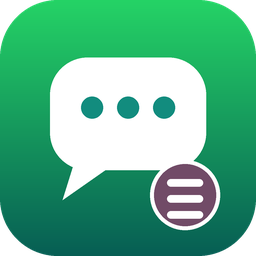
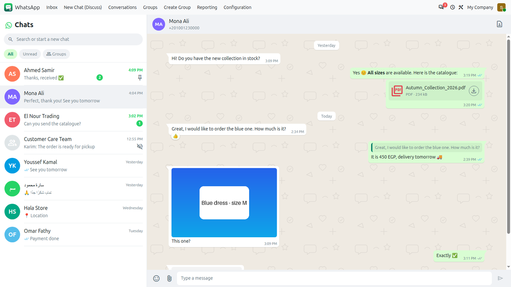
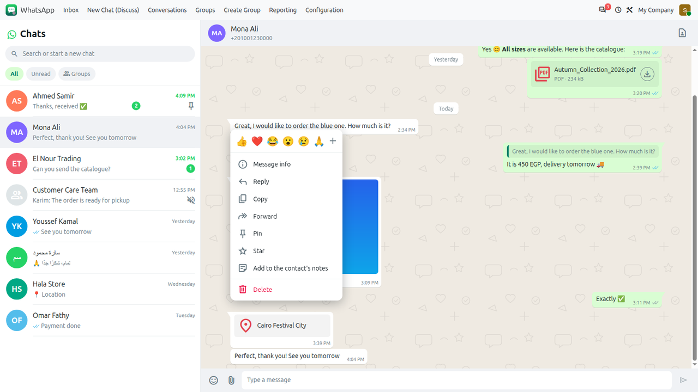
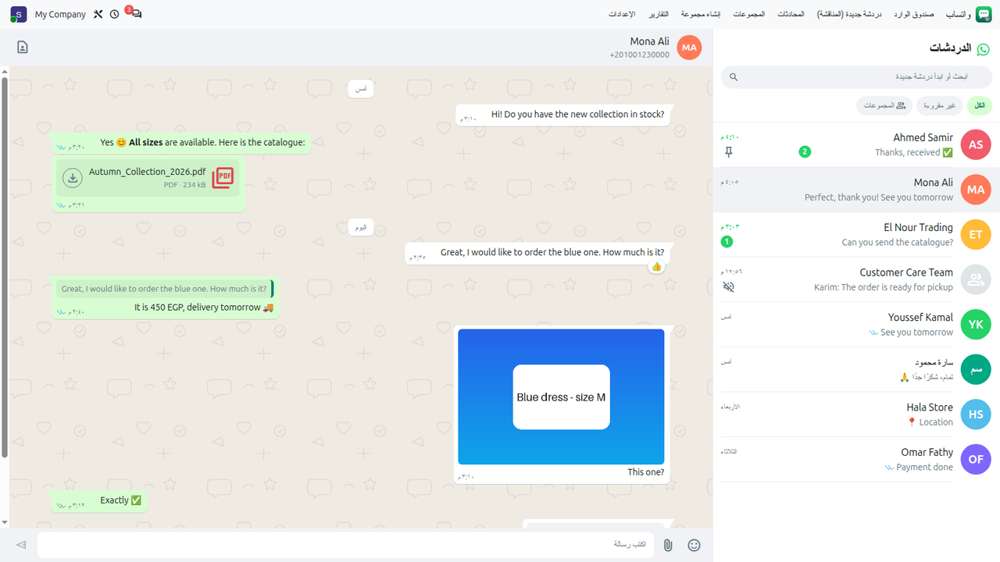
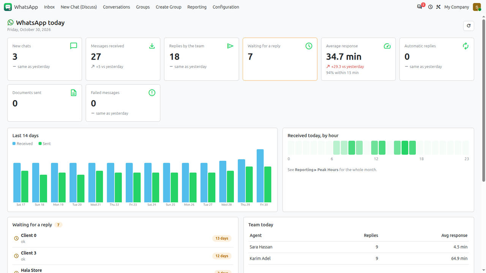
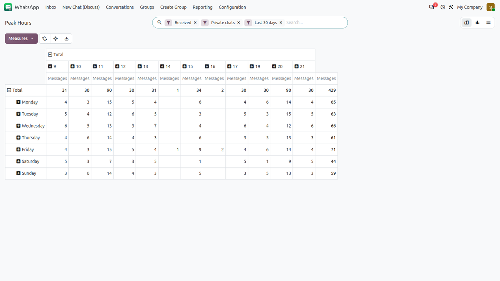
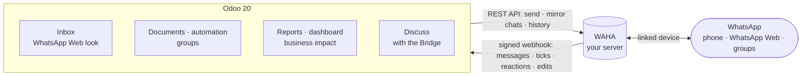
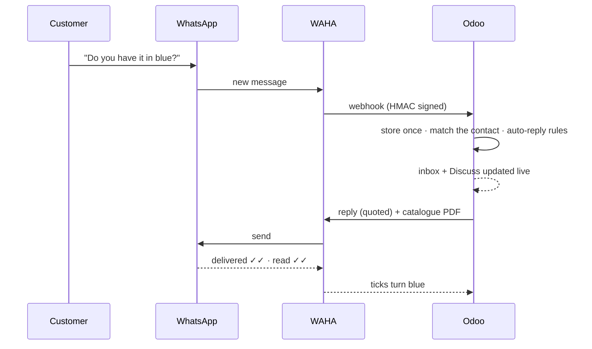

<div align="center">



# Elblasy WhatsApp (WAHA) for Odoo 20

**WhatsApp inside Odoo, the way your team already knows it.**<br/>
A WhatsApp Web inbox, groups, documents from any app, automation, reports and a live dashboard —
powered by the [WAHA](https://waha.devlike.pro) server **you** control.

واتساب داخل أودو كما يعرفه فريقك: صندوق وارد مثل واتساب ويب، مجموعات، مستندات، أتمتة، تقارير ولوحة متابعة


[Screens](#-screens) · [Features](#-features) · [How it works](#-how-it-works) · [Install](#-install) ·
[Reports](#-reporting--business-impact) · [FAQ](#-faq) · [بالعربية](#-بالعربية)



</div>

---

## ✨ Why

| | |
|---|---|
| 💬 **No templates, no 24 h window** | Start any conversation with free text, from your existing number. |
| 🧭 **Zero training** | The inbox looks and behaves like WhatsApp Web — the same chat list, bubbles, ticks and menus. |
| 🧾 **Connected to the business** | Send quotations, invoices or any document; see which sales followed a chat. |
| 🔒 **Yours** | Sessions, media and history stay on your WAHA server and your Odoo database. |

## 📦 Addons

| Addon | Edition | What it does |
|---|---|---|
| [`elblasy_waha_connector`](elblasy_waha_connector) — **Elblasy WhatsApp (WAHA)** | Community & Enterprise | Sessions, inbox, message actions, groups, documents, automation, auto-replies, reports, dashboard. |
| [`elblasy_waha_whatsapp_bridge`](elblasy_waha_whatsapp_bridge) — **Elblasy WhatsApp Bridge** | Enterprise | Runs Odoo's own WhatsApp app (Discuss, templates, chatter) through a WAHA session: free text to anyone, at any time. |

## 🖼 Screens

<table>
<tr>
<td width="50%"><br/><b>WhatsApp's menu on every message</b> — react, reply, copy, edit, forward, pin, star, keep in the contact's notes, delete.</td>
<td width="50%"><br/><b>Arabic, right to left</b> — fully translated, mirrored like WhatsApp in Arabic.</td>
</tr>
<tr>
<td><br/><b>Dashboard</b> — today vs yesterday, last 14 days, hours, waiting list, team.</td>
<td><br/><b>Peak hours</b> — messages by weekday × hour in your time zone.</td>
</tr>
</table>

<sub>Screens of the module with sample data.</sub>

## 🚀 Features

<details open>
<summary><b>💬 Inbox like WhatsApp Web</b></summary>

- **Same chat list as the phone**, mirrored from WhatsApp: order, pinned, archived (own list), muted, names, pictures, unread counts, last message — even when a webhook was missed.
- **Filters**: All · Unread · Groups · every WhatsApp Business label; search by name or number.
- **Every kind of message**: text with `*bold*` / `_italic_` / links, photos, stickers, voice notes, videos, PDF/document cards, locations (open in Maps), contact cards, polls.
- **Real conversations**: quoted replies, reactions, *Edited*, *This message was deleted*, *Forwarded*, day separators, read more, pinned banner, grey and blue ticks.
- **History on demand**: opening a chat imports what Odoo missed; scrolling up loads older messages from WhatsApp.
- **Contact info panel** (click the chat header): big photo, *About*, notes about the customer, media / links / docs, search in the chat with jump to the message, group members, archive, mark as unread, and the customer's documents in Odoo.
- **Photo viewer** like WhatsApp: pictures and videos open inside Odoo with zoom, previous / next, thumbnails, reply, star, pin, react, forward and download.
- **Link previews** before sending (title, description, picture — close to send without) and inside received messages.
- **Voice notes** played in the bubble (progress, duration); pictures and voice notes load by themselves within the media size limit.
- Emoji picker · dark theme · Arabic RTL · one pane at a time on phones · live updates.
</details>

<details>
<summary><b>🧰 Message actions</b> — the menu of every bubble</summary>

| Action | Details |
|---|---|
| React | 6 quick reactions + emoji picker; click again to remove |
| Reply | Delivered as a real quoted WhatsApp reply |
| Copy · Message info | Date, status, sender, automatic or not, error |
| Edit | Your own text messages, 15 minutes (WhatsApp's rule) |
| Forward | Up to 5 chats of the same number |
| Pin · Star | Pin for 24 h / 7 days / 30 days |
| Add to the contact's notes | Message and files posted in the contact's chatter |
| Delete | For everyone (author or manager) or for me (reports keep it) |
</details>

<details>
<summary><b>👥 Groups</b></summary>

- Groups in the inbox with each author's name; **auto-replies never run in groups**.
- Sync groups with members and pictures; create groups from contacts; add/remove members; invite links.
- Whitelist of groups allowed to receive messages from Odoo; link groups to customers so their documents reach them too.
- Optional message log for chosen groups (90 days).
</details>

<details>
<summary><b>📤 Send from anywhere in Odoo</b></summary>

- **Send to WhatsApp** on quotations, invoices, deliveries, purchases, tasks, tickets, contacts, employees… text + the document's PDF, to the customer and its groups.
- **Automation rules**: server action *Send WhatsApp* for any trigger, through a throttled queue that sends each item **at most once** (even after a crash).
- Instant buttons on contacts and employees; local numbers (`010…`) get the contact's country code; WhatsApp existence check.
</details>

<details>
<summary><b>🤖 Auto-replies, opt-out, calls</b></summary>

- Auto-replies on the first message, on keywords or outside business hours (time zone + weekdays), with a per-chat cooldown.
- Opt-out / opt-in keywords in any language stop automatic messages to a number.
- Optional rejection of WhatsApp calls with a short message.
</details>

<details>
<summary><b>🗂 Media & storage</b></summary>

- Per session: download **all files**, files **up to a size limit** (default 10 MB, videos on demand) or **on demand only**; group media on demand by default.
- Files left on WhatsApp show a *Download* card; automatic deletion after N days (texts always kept); identical files stored once by Odoo.
</details>

<details>
<summary><b>🛡 Security & reliability</b></summary>

- Roles **User / Manager / Administrator**; users read conversations, writes go through checked methods; multi-company rules on every model.
- Webhook signed with **HMAC-SHA512**, per-session secret URL, idempotent event store, instant processing with automatic retries.
- Idempotency tokens on every send, at-most-once queue, rate limits, no secrets in logs.
- **110+ automated tests**, including Chrome tests of the inbox, the reports and the style sheets (LTR, RTL, dark).
</details>

## 🏗 How it works





## 📊 Reporting & business impact

| Report | Answers |
|---|---|
| **Waiting for a Reply** | Who is waiting, since when? |
| **Messages** | Search by phone, contact, chat, agent or text; group by contact, type, weekday, hour |
| **Customers & Chats** | Volumes, first/last contact, response times, customers silent for 30+ days |
| **Peak Hours** | When do customers write (weekday × hour, company time zone)? |
| **Agents** | Replies and average response time per person and week |
| **Sent Documents** | Every document sent on WhatsApp, from any app or template |
| **Business from WhatsApp** | Which quotations, invoices, leads, POS orders, tickets… **any model** followed a WhatsApp chat, with amounts |
| **Dashboard** | Today vs yesterday, last 14 days, hours, waiting list, team, business |

Configure the documents to measure in *WhatsApp ▸ Configuration ▸ Tracked Documents* (any model with a date and a customer, optional amount, filter and window in days).

## ⚖️ WAHA or Meta Cloud API?

| | Elblasy WhatsApp (WAHA) | Meta Cloud API (Odoo native) |
|---|---|---|
| Start a conversation | Free text, any time | Approved template outside 24 h |
| Cost per conversation | None (your server) | Charged by Meta |
| Groups | Read, send, create, manage | — |
| Number & history | Your existing number, linked like WhatsApp Web | Dedicated API number |
| Status | Unofficial (WhatsApp Web protocol) | Official |

> [!IMPORTANT]
> WAHA is not an official Meta API. Avoid bulk campaigns and unsolicited messages; the module rate-limits sending and honours opt-outs.

## 🔧 Install

**Requirements**: Odoo 20.0 · a WAHA server (tested with the WEBJS engine, WAHA 2026.x) · Python `requests` (see [`requirements.txt`](requirements.txt)) · the bridge needs Odoo Enterprise with *WhatsApp*.

<details open>
<summary><b>Odoo.sh</b></summary>

1. Add this repository to your Odoo.sh project (as a submodule or the project repository) and push.
2. Install **Elblasy WhatsApp (WAHA)** — and **Elblasy WhatsApp Bridge** if you want Odoo's WhatsApp app over WAHA.
3. *WhatsApp ▸ Configuration ▸ Servers*: WAHA URL + API key → **Test Connection**; set **Odoo Public URL** (`https://<your>.odoo.com`).
4. *Sessions*: create → **Connect** → scan the QR code. The webhook is registered automatically.
5. Staging branches neutralize crons; webhook processing still works (it runs in the request).
</details>

<details>
<summary><b>Your own server</b></summary>

```bash
# WAHA (see https://waha.devlike.pro for production options)
docker run -d --name waha -p 3000:3000 -e WAHA_API_KEY=change-me devlikeapro/waha

# Odoo
git clone git@github.com:elblasy33/elblasy-waha.git /opt/odoo/extra-addons/elblasy-waha
pip install -r /opt/odoo/extra-addons/elblasy-waha/requirements.txt
./odoo-bin -c odoo.conf -d mydb -i elblasy_waha_connector   # add elblasy_waha_whatsapp_bridge on Enterprise
```

For Arabic right-to-left layouts Odoo needs [`rtlcss`](https://rtlcss.com/) on the server: `npm install -g rtlcss`.
A laptop that WAHA cannot reach can switch on **Auto-sync messages** on the session (polling every minute).
</details>

## 🧪 Tests

```bash
./odoo-bin -c odoo.conf -d test_db -i elblasy_waha_connector,elblasy_waha_whatsapp_bridge \
  --test-tags /elblasy_waha_connector,/elblasy_waha_whatsapp_bridge --stop-after-init
```

WAHA is mocked; the browser tests need Chrome. The suite covers webhooks, idempotency, groups, media policy, the chat-list mirror, history import, message actions, reports, the dashboard, the bridge (send/receive/templates/replies from the phone), access rights, and compiles the LTR, RTL and dark style sheets.

## 🗂 Project structure

```text
elblasy_waha_connector/          main app (Community & Enterprise)
├── controllers/                 signed webhook endpoint
├── models/                      sessions, conversations, messages, groups, queue, reports, dashboard…
├── wizard/                      send to WhatsApp, create group, manage members
├── static/src/inbox/            OWL inbox (WhatsApp Web look, RTL, dark)
├── static/src/dashboard/        OWL dashboard
├── i18n/ar.po                   Arabic
└── tests/                       Python + Chrome tests
elblasy_waha_whatsapp_bridge/    Odoo WhatsApp app over WAHA (Enterprise)
├── patch.py                     routes WhatsAppApi calls to WAHA
├── tools/transport.py           WAHA ⇄ Meta payload translation
└── tests/
```

Technical notes for developers: [`elblasy_waha_connector/README.md`](elblasy_waha_connector/README.md).

## ❓ FAQ

<details><summary><b>Does the phone keep working?</b></summary>
Yes. WAHA is a linked device: phone, WhatsApp Web and Odoo show the same chats, and messages sent from the phone also appear in Odoo (and in Discuss with the bridge).
</details>
<details><summary><b>How much disk space do files use?</b></summary>
You decide per session: all files, a size limit or on demand only, with automatic deletion after N days.
</details>
<details><summary><b>Do approved templates still work with the bridge?</b></summary>
Yes. They are rendered in Odoo and sent as text, with their header document or image attached.
</details>
<details><summary><b>Can I measure sales coming from WhatsApp?</b></summary>
Yes — <i>Reporting ▸ Business from WhatsApp</i>, for any model you add in <i>Tracked Documents</i>.
</details>

## 🇪🇬 بالعربية

<div dir="rtl">

**Elblasy WhatsApp (WAHA)** يربط أودو 20 بخادم WAHA الخاص بك، فيعمل فريقك على واتساب من داخل أودو كما يعمل على واتساب ويب.

- **صندوق الوارد:** لوحة معلومات جهة الاتصال (النبذة، الملاحظات، الوسائط والروابط والمستندات، البحث داخل الدردشة، الأرشفة)، رسائل صوتية تُشغَّل داخل الفقاعة، ونفس قائمة محادثات الهاتف وبنفس الترتيب (المثبتة، المؤرشفة، المكتومة، الأسماء والصور وغير المقروء)، كل أنواع الرسائل، الردود والتفاعلات والتعديل والحذف وعلامات القراءة.
- **قائمة كل رسالة:** تفاعل، رد، نسخ، تعديل، إعادة توجيه، تثبيت، نجمة، إضافة لملاحظات جهة الاتصال، حذف للجميع أو لي.
- **المجموعات:** في صندوق الوارد باسم كاتب كل رسالة، مزامنة وإنشاء وإدارة الأعضاء وربطها بالعملاء.
- **الإرسال من أي مكان:** عروض الأسعار والفواتير وأي مستند مع ملف PDF، وقواعد أتمتة بطابور آمن لا يرسل مرتين.
- **ردود تلقائية وإلغاء اشتراك** ورفض المكالمات.
- **التقارير:** في انتظار رد، الرسائل مع البحث بالهاتف وجهة الاتصال، العملاء، الموظفون، ساعات الذروة، المستندات المرسلة، والأعمال القادمة من واتساب لأي مستند، ولوحة متابعة يومية.
- **الوسائط:** تحكم كامل في التنزيل والمساحة مع حذف تلقائي للملفات القديمة.
- **العربية:** ترجمة كاملة وواجهة من اليمين لليسار.
- **الجسر (Enterprise):** تطبيق واتساب الأصلي في أودو يعمل عبر WAHA برسائل حرة بلا قوالب ولا نافذة 24 ساعة، وتظهر فيه ردودك من الهاتف.

> تنبيه: WAHA ليس واجهة رسمية من ميتا؛ تجنب الرسائل الجماعية غير المطلوبة.

</div>

## 📄 License

[LGPL-3](https://www.gnu.org/licenses/lgpl-3.0.html) · Made by **[Elblasy.app](https://elblasy.app)**.
WAHA is a project of devlike.pro; WhatsApp is a trademark of Meta. This project is not affiliated with Meta, WhatsApp, Odoo S.A. or devlike.pro.
